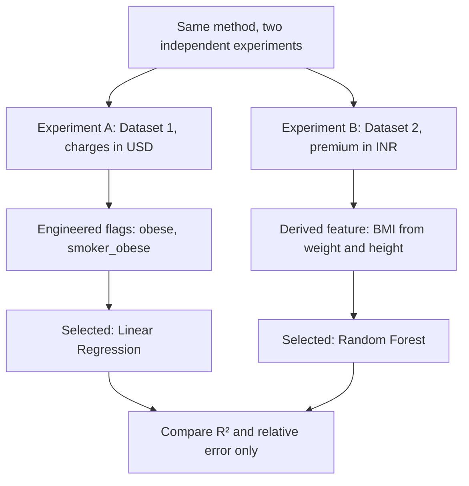

# Medical Insurance Cost Prediction Using Machine Learning

### A Two-Dataset Comparative Study | Predictive Analytics CA3


[](https://colab.research.google.com/github/YOUR-USERNAME/medical-insurance-cost-prediction/blob/main/notebooks/Medical_Insurance_Cost_Prediction_CA3.ipynb)

Machine learning regression pipelines that predict **(A)** individual medical charges in USD and **(B)** health insurance premiums in INR, and identify which features are most associated with each target. The two datasets are independent, so each gets its own experiment and the results are compared cautiously.

> **Author:** Srushti Kale, B.Tech CSE (AI & ML), Symbiosis Institute of Technology, Nagpur

---

## Table of contents

1. [Results at a glance](#results-at-a-glance)
2. [Problem statement](#problem-statement)
3. [Datasets](#datasets)
4. [Workflow](#workflow)
5. [Data understanding and preprocessing](#data-understanding-and-preprocessing)
6. [Models and tuning](#models-and-tuning)
7. [Evaluation and results](#evaluation-and-results)
8. [Feature importance and interpretation](#feature-importance-and-interpretation)
9. [Exploratory data analysis figures](#exploratory-data-analysis-figures)
10. [Repository structure](#repository-structure)
11. [How to run](#how-to-run)
12. [Limitations](#limitations)
13. [Future work](#future-work)
14. [References and acknowledgements](#references-and-acknowledgements)

---

## Results at a glance

| | Experiment A: Medical charges | Experiment B: Premium pricing |
|---|---|---|
| Dataset | `insurance.csv` (Dataset 1) | `Medicalpremium.csv` (Dataset 2) |
| Target | `charges` (USD) | `PremiumPrice` (INR) |
| Unique rows | 1,337 | 986 |
| Selected model | Linear Regression with interaction flags | Random Forest Regressor |
| Cross-validated R² | 0.8425 | 0.7139 |
| **Test R²** | **0.9179** | **0.8674** |
| Test MAE | $2,140 (16.49% of mean target) | ₹1,483 (6.03% of mean target) |
| Test RMSE | $3,440 (26.51% of mean target) | ₹2,378 (9.66% of mean target) |
| Train-test R² gap | -0.0681 | +0.0036 |
| Top features | `smoker_obese`, `smoker`, `age` | `Age`, `AnyTransplants`, `AnyChronicDiseases` |


> USD and INR cannot be compared directly, so the two experiments are compared using unit-free measures only (R² and error as a percentage of the mean target).

---

## Problem statement

Insurers must price premiums so that they stay competitive and still cover claims. Fixed, rule-based pricing can miss how features combine, for example smoking together with obesity. This project asks:

- **Experiment A:** can annual medical charges (USD) be predicted from demographic and lifestyle data?
- **Experiment B:** can the health insurance premium (INR) be predicted from clinical history and body measurements?
- **Both:** which features are most associated with the predicted cost?

Both are **regression** tasks (predicting a number rather than a category).

---

## Datasets

| | Dataset 1 | Dataset 2 |
|---|---|---|
| File | `insurance.csv` | `Medicalpremium.csv` |
| Name | Medical Cost Personal Dataset | Medical Insurance Premium Prediction |
| Source | [Kaggle](https://www.kaggle.com/datasets/mirichoi0218/insurance) (CSV originally from [stedy/Machine-Learning-with-R-datasets](https://github.com/stedy/Machine-Learning-with-R-datasets)) | [Kaggle](https://www.kaggle.com/datasets/tejashvi14/medical-insurance-premium-prediction) (login required) |
| Unique rows | 1,337 (1 exact duplicate removed) | 986 |
| Target | `charges`: billed medical cost in USD, $1,121.87 to $63,770.43, right-skewed (skewness 1.52) | `PremiumPrice`: yearly premium in INR, ₹15,000 to ₹40,000, 24 distinct price tiers |
| Predictors | age, sex, BMI, children, smoker, region | Age, Diabetes, BloodPressureProblems, AnyTransplants, AnyChronicDiseases, Height, Weight, KnownAllergies, HistoryOfCancerInFamily, NumberOfMajorSurgeries |
| Missing values | None | None |

**Why two separate experiments?** The targets are different concepts in different currencies (billed medical cost in USD versus yearly premium in INR), and the only overlapping column is age. A model trained on one dataset therefore cannot be meaningfully validated on the other, so no external validation is claimed. The same method is applied independently to each dataset instead.

The CSV files are **not included** in this repository. See [`data/README.md`](data/README.md) for download instructions.

---

## Workflow




---

## Data understanding and preprocessing

### Experiment A (Dataset 1)

- No missing values; one exact duplicate row removed before splitting.
- **EDA finding:** smoking and obesity interact. Obese smokers have a much higher median charge than obese non-smokers (about $40,904 versus $8,084).
- **Engineered features:** `obese` (BMI of 30 or more) and `smoker_obese` (smoker and BMI of 30 or more). They are calculated row by row from each person's own inputs, so they do not use the target.
- **Pipeline:** `StandardScaler` for `age`, `bmi`, `children`; `OneHotEncoder` for `sex`, `smoker`, `region`.

### Experiment B (Dataset 2)

- No missing values; no duplicates.
- **Derived feature:** BMI = weight / (height in metres)², range 15.2 to 50.0.
- **Pipeline:** numeric columns scaled; the 0/1 health flags are passed through unchanged.

### Leakage safeguards

- 80/20 train-test split for both datasets; Dataset 1 is stratified by smoking status (20.5% smokers) so both parts keep the same proportion.
- Duplicates are removed before the split.
- All encoding and scaling live **inside** a scikit-learn `Pipeline`, so they are learned from training data only.
- Models are selected with 5-fold cross-validation on the training split (`KFold`, shuffled, `random_state=42`). The test set is used once, for the final report.

---

## Models and tuning

| Algorithm | Idea in simple words |
|---|---|
| Baseline (Dummy) | Always predicts the training mean |
| Linear Regression (OLS) | One straight-line formula |
| Ridge Regression | Linear model with an L2 penalty |
| Decision Tree | Flowchart of yes/no questions |
| Random Forest | Bagging: many trees, averaged |
| Gradient Boosting | Boosting: each tree corrects earlier errors |

Tree-based models were tuned with `GridSearchCV` (5-fold CV on the training split, scored by RMSE):

| Model | Best settings found |
|---|---|
| Decision Tree | `max_depth` 6, `min_samples_leaf` 10 |
| Random Forest | `n_estimators` 400, `max_depth` 6, `min_samples_leaf` 1 (Dataset 2) or 5 (Dataset 1) |
| Gradient Boosting | Dataset 2: 100 estimators, learning rate 0.05, depth 3 |

### Feature engineering made a measurable difference (Dataset 1)

Across the compared models, adding the engineered flags lowered the average cross-validated RMSE from 5,862.6 to 5,172.9. Once the interaction was explicit, a plain linear model became the best performer.


---

## Evaluation and results

**Metrics in simple words**

| Metric | Meaning | Better is |
|---|---|---|
| MAE | Average size of the mistake, in the target's unit | Lower |
| RMSE | Like MAE, but big mistakes count more | Lower |
| R² | Share of the variation in the target that the model explains | Higher |

**Selection rule:** the model with the lowest cross-validated RMSE on the training data is chosen, then evaluated once on the unseen test set.

- **Experiment A: Linear Regression.** After the `smoker_obese` interaction was added as a feature, a simple linear model captured the non-linear effect. CV R² 0.8425, test R² 0.9179.
- **Experiment B: Random Forest.** Premium depends on combinations of medical history, which the forest handled best. CV R² 0.7139, test R² 0.8674.


**Overfitting check:** the train-test R² gap is small in both experiments (-0.0681 and +0.0036). In Experiment A the gap is negative, meaning the test score happened to be higher than the training score.

---

## Feature importance and interpretation

Permutation importance shuffles one feature at a time on the test set and measures how much R² drops. A bigger drop means the model relied on that feature more.

| Experiment A: charges (Dataset 1) | Experiment B: premium (Dataset 2) |
|---|---|
|  |  |

| Experiment | Top features (approximate R² drop) | Reading |
|---|---|---|
| A: Charges | `smoker_obese` (~0.55), `smoker` (~0.40), `age` (~0.20) | Smoking combined with obesity is the highest-cost profile in this dataset. |
| B: Premiums | `Age` (~1.15), `AnyTransplants` (~0.22), `AnyChronicDiseases` (~0.08) | Age dominates by a wide margin. |

> **Associations, not causes.** Importance describes what the model uses to predict, not what causes higher cost. Nothing in this project is medical or financial advice.

---

## Charts from the notebook

All charts below are produced by the notebook and saved automatically (Section 17 / last cell gives a `figures.zip` download). They are numbered in the order they appear.

### Dataset 1: exploratory analysis

| | |
|---|---|
|  |  |
| Target distribution, raw and log-transformed | Age and BMI distributions |
|  |  |
| Charges by smoking status, and charges vs age | Charges vs BMI, and average charges by number of children |
|  |  |
| Average charges by sex and by region | Correlation heatmap |
|  |  |
| Outlier analysis (IQR rule) | Smoking x obesity interaction behind the engineered features |

### Experiment A: model results (Dataset 1)


*Test MAE, RMSE and R² for each model.*


*Actual vs predicted values, residuals vs predicted, and the residual distribution for the selected model.*

### Dataset 2: exploratory analysis


| | |
|---|---|
|  |  |
| Average premium by each health flag | Correlation heatmap |

### Experiment B: model results (Dataset 2)


*Test MAE, RMSE and R² for each model.*


*Actual vs predicted values, residuals vs predicted, and the residual distribution for the selected model.*

---

## Repository structure

```
medical-insurance-cost-prediction/
├── README.md
├── requirements.txt
├── .gitignore
├── data/
│   └── README.md                         # where to download the CSV files
├── notebooks/
│   ├── Medical_Insurance_Cost_Prediction_CA3.ipynb   # step-by-step notebook (Markdown + code cells)
│   └── Medical_Insurance_CA3_single_cell.ipynb       # whole project in one cell
├── src/
│   └── make_report_figures.py            # summary charts used in this README
└── images/                               # all figures used in this README
```

---

## How to run

### Option 1: Google Colab (easiest)

1. Click the **Open in Colab** badge at the top (after you push the repo and replace `YOUR-USERNAME` in the badge link), or upload the notebook from `notebooks/` to [colab.research.google.com](https://colab.research.google.com).
2. Run all cells. `insurance.csv` is downloaded automatically; if that fails, an upload box appears.
3. When the upload box appears for `Medicalpremium.csv`, choose the file you downloaded from Kaggle.
4. At the end, `figures.zip` is downloaded. Unzip it into the `images/` folder of this repository (keep the file names) so the charts in this README display.

### Option 2: Run locally

```bash
git clone https://github.com/YOUR-USERNAME/medical-insurance-cost-prediction.git
cd medical-insurance-cost-prediction
pip install -r requirements.txt

# 1) put insurance.csv and Medicalpremium.csv into data/ (see data/README.md)
# 2) open the notebook; keep the two CSV files in the same folder as the notebook, or in Colab's file panel
jupyter notebook notebooks/Medical_Insurance_Cost_Prediction_CA3.ipynb

# 3) regenerate figures
python src/make_report_figures.py                  # summary charts (no data needed)
```

Running the notebook also creates a `figures/` folder with all 17 notebook charts; copy them into `images/`.

The notebook contains the full KDD workflow with Markdown explanations: data collection and quality checks, cleaning, EDA, feature engineering, leak-free pipelines, five models plus a baseline, tuning, evaluation, permutation importance and a conclusion.

---

## Limitations

- **Teaching datasets.** Dataset 1 is a small, widely reused textbook dataset, and some documentation describes it as simulated from US census demographics. Results may not represent real insurer portfolios.
- **No external validation.** The two targets are different concepts in different currencies and share only age, so the Dataset 1 model was not tested on Dataset 2.
- **Single split.** The final scores come from one 80/20 split. In both experiments the test R² is higher than the cross-validated R², which can happen with a single split; treat the test figures as one estimate rather than a guarantee.
- **Association only.** Permutation importance shows predictive reliance, not causation, and is shared among correlated features.
- **Missing context.** Real pricing depends on things not recorded here (claims history, plan type, income, insurer rules).
- **Fairness and privacy.** The data include personal and health attributes (for example sex and region). Models like these need fairness checks and external validation before any real-world use. This project is for learning, not for pricing decisions.

---

## Future work

- Wider hyperparameter search; try `RidgeCV`, ElasticNet, XGBoost or LightGBM.
- Model `log(charges)` and compare; use repeated cross-validation with confidence intervals.
- Add SHAP values for richer explanations.
- Find a second dataset with the **same target definition** to allow genuine external validation.
- Check fairness across groups (sex, region) before any real-world use.

---

## References and acknowledgements

- Lantz, B. *Machine Learning with R* (source of the Medical Cost Personal Dataset). Dataset: [Kaggle](https://www.kaggle.com/datasets/mirichoi0218/insurance).
- Medical Insurance Premium Prediction dataset: [Kaggle, tejashvi14](https://www.kaggle.com/datasets/tejashvi14/medical-insurance-premium-prediction).
- Built with Python, pandas, NumPy, scikit-learn, Matplotlib and Seaborn.

Check each dataset page for its licence and terms of use. No licence has been chosen for this repository yet; add a `LICENSE` file before sharing it publicly if you want others to reuse the code.
